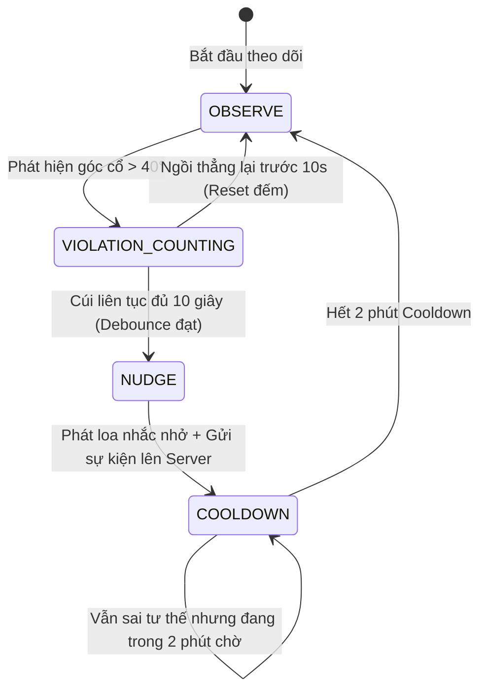
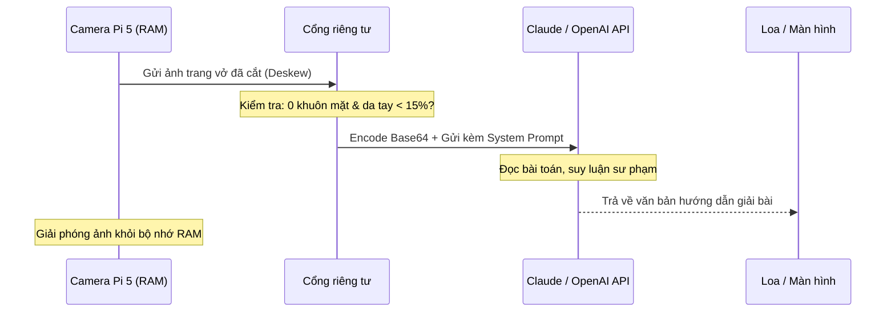

# CẨM NANG TOÀN DIỆN TUẦN 1: TỪ KHÁI NIỆM ĐẾN THỰC HÀNH

> [!IMPORTANT]
> Tài liệu này được biên soạn chi tiết dựa trên bảng công việc **Tuần 1 — Giai đoạn 1: Tìm hiểu, thiết lập môi trường** và các tài liệu kỹ thuật cốt lõi của đề tài. Mỗi chủ đề bao gồm: **Khái niệm**, **Mục đích trong đồ án**, **Ví dụ trực quan**, **Cách vận dụng & Code mẫu**, và **Tài liệu/Bài viết nên đọc**.

---

## MỤC LỤC
1. [CHƯƠNG 1: NỀN TẢNG HỆ THỐNG & PHẦN CỨNG (CẢ NHÓM CẦN BIẾT)](#chương-1-nền-tảng-hệ-thống--phần-cứng-cả-nhóm-cần-biết)
   - 1.1. Bộ phần cứng Raspberry Pi 5 & Các phụ kiện bắt buộc (Nhiệm vụ 1)
   - 1.2. Cấu trúc kho mã nguồn Git chuẩn (Nhiệm vụ 6)
   - 1.3. Schema sự kiện JSON & Cơ chế "Cấm lưu/nhận ảnh" (Nhiệm vụ 7)
   - 1.4. Khung pháp lý & 6 Nguyên tắc bất biến (Nhiệm vụ 9)
2. [CHƯƠNG 2: THỊ GIÁC MÁY TÍNH & CAMERA (AI & BE CÙNG NẮM)](#chương-2-thị-giác-máy-tính--camera-ai--be-cùng-nắm)
   - 2.1. Cơ chế Lấy nét tự động: "Auto" vs "Windows + Trigger" (Nhiệm vụ 4)
   - 2.2. Bài toán góc nhìn camera đơn: Bao phủ Đầu-Vai & Vùng viết (Nhiệm vụ 5)
   - 2.3. Ring Buffer trong RAM: Lưu trữ không chạm đĩa cứng (Nhiệm vụ 3)
3. [CHƯƠNG 3: TRÍ TUỆ NHÂN TẠO CỤC BỘ (CHUYÊN SÂU NHÓM AI)](#chương-3-trí-tuệ-nhân-tạo-cục-bộ-chuyên-sâu-nhóm-ai)
   - 3.1. Google MediaPipe Tasks API & PoseLandmarker (Nhiệm vụ 2 & Chuẩn bị Tuần 2)
   - 3.2. Thuật toán tính góc tư thế: Góc gập cổ & Góc nghiêng vai
   - 3.3. Cơ chế Debounce (Lọc thời gian) & Cooldown (Giãn cách nhắc nhở)
4. [CHƯƠNG 4: TRỢ LÝ AI ĐÁM MÂY (CHUYÊN SÂU NHÓM AI)](#chương-4-trợ-lý-ai-đám-mây-chuyên-sâu-nhóm-ai)
   - 4.1. Vision API & Quy trình mã hóa ảnh Base64 (Nhiệm vụ 8)
   - 4.2. Kỹ thuật Prompt Engineering sư phạm cho lứa tuổi 6–12
   - 4.3. Quản lý Token, Chi phí và Đo lường độ trễ (Latency)

---

# CHƯƠNG 1: NỀN TẢNG HỆ THỐNG & PHẦN CỨNG (CẢ NHÓM CẦN BIẾT)

---

### 1.1. BỘ PHẦN CỨNG RASPBERRY PI 5 & PHỤ KIỆN BẮT BUỘC (Nhiệm vụ 1)

#### a. Khái niệm
* **Raspberry Pi 5 (Pi 5):** Một máy tính đơn bo mạch (Single Board Computer - SBC) kích thước bằng lòng bàn tay, chạy chip xử lý 64-bit Broadcom BCM2712 (4 nhân Cortex-A76 tốc độ 2.4 GHz), có đầy đủ cổng USB, HDMI, mạng LAN và các cổng camera chuyên dụng.
* **Nguồn USB-C 27W (5.1V / 5A):** Củ nguồn chuẩn hỗ trợ công nghệ Power Delivery đặc thù của hãng Raspberry Pi.
* **Cáp camera FPC 22-pin pitch 0.5mm:** Cáp dẹp nhiều lõi truyền dữ liệu hình ảnh băng thông cao từ camera về chip xử lý.
* **Active Cooler:** Cụm tản nhiệt gồm phiến nhôm tản nhiệt kết hợp với quạt điều tốc PWM tự động quay nhanh/chậm tùy theo nhiệt độ chip.

#### b. Vì sao cần trong dự án?
* Dự án chạy mô hình AI trực tiếp trên máy tính biên (Edge Computing). Pi 5 mạnh gấp 2–3 lần Pi 4, đủ sức chạy Pose Estimation ở mức 10–15 FPS mà không cần card đồ họa rời.
* Nếu dùng nguồn sạc điện thoại thường (10W–18W), khi chạy AI tải nặng, chip sẽ bị tụt áp $\rightarrow$ Pi 5 sẽ tự sập nguồn hoặc treo máy giữa chừng.
* Nếu không có Active Cooler, nhiệt độ chip sẽ vượt quá $80^\circ\text{C}$ sau 5 phút $\rightarrow$ cơ chế an toàn của chip sẽ kích hoạt "Thermal Throttling" (tự hạ xung nhịp từ 2.4GHz xuống còn 1.5GHz) khiến camera bị giật hình, tụt FPS thê thảm.

#### c. Ví dụ trực quan
Hãy tưởng tượng Pi 5 như một chiếc xe đua mini. Nếu bạn đổ "xăng dỏm" (nguồn yếu 15W), xe sẽ chết máy giữa đường. Nếu xe chạy hết tốc lực mà không có "két nước làm mát" (Active Cooler), động cơ bốc khói và phải bò lết với tốc độ rùa bò.

#### d. Cách vận dụng & Kiểm tra
1. Lắp quạt Active Cooler: Ấn 2 chốt lò xo vào 2 lỗ trên bo mạch Pi 5, cắm dây quạt vào cổng 4-pin FAN kế bên cổng Ethernet.
2. Cắm cáp camera: Mở nhẹ lẫy đen của cổng **CAM0** hoặc **CAM1** trên Pi 5, đưa cáp dẹp 22-pin vào (mặt tiếp xúc kim loại hướng về phía cổng HDMI), ấn lẫy đen xuống để khóa chặt.
3. Kiểm tra nhiệt độ và nguồn trong Terminal của Pi:
   ```bash
   # Xem nhiệt độ chip realtime
   vcgencmd measure_temp
   # Kiểm tra xem máy có từng bị sụt nguồn hay hạ xung do nóng không
   vcgencmd get_throttled
   # Kết quả 'throttled=0x0' nghĩa là nguồn điện và nhiệt độ hoàn hảo!
   ```

#### e. Tài liệu nên đọc
* 🔗 [Tài liệu chính thức Raspberry Pi 5 Hardware Specs](https://www.raspberrypi.com/documentation/computers/raspberry-pi-5.html)
* 🔗 [Hướng dẫn gắn camera và cáp trên Raspberry Pi](https://www.raspberrypi.com/documentation/computers/camera_software.html)

---

### 1.2. CẤU TRÚC KHO MÃ NGUỒN GIT CHUẨN (Nhiệm vụ 6)

#### a. Khái niệm
Repository (Repo) Git là kho lưu trữ toàn bộ mã nguồn của dự án có lịch sử theo dõi thay đổi. Để 7 người không dẫm chân lên nhau, mã nguồn được phân cấp theo kiến trúc hệ thống 2 tầng (Edge - Cloud).

#### b. Cấu trúc chuẩn theo File 04 của Thầy
```text
robot/
├── edge/                   # Chạy cục bộ trên Raspberry Pi 5
│   ├── capture/            # Thu hình từ camera, điều khiển autofocus, ring buffer
│   ├── perception/         # Các module AI: pose.py, attention.py, page_detect.py
│   ├── privacy/            # Cổng bảo mật: gate.py (chặn mặt, lọc da tay)
│   ├── events/             # Bộ máy điều phối trạng thái: event_engine.py
│   ├── llm/                # Client gọi API vision, prompts hệ thống
│   ├── dialog/             # Âm thanh: tts.py, stt.py (nếu có)
│   └── config.yaml         # Các ngưỡng cấu hình: góc cổ, thời gian, FPS...
├── server/                 # Chạy trên máy chủ / laptop của phụ huynh
│   ├── api.py              # FastAPI server, validate schema sự kiện (chặn ảnh)
│   ├── db.py               # Kết nối cơ sở dữ liệu SQLite/PostgreSQL
│   └── web/                # Giao diện Dashboard (HTML/CSS/JS)
├── eval/                   # Các script đo đạc số liệu định lượng (Q1 -> Q13)
├── tests/                  # Bộ test tự động (test 0 ghi đĩa, test từ chối ảnh 422)
├── docs/                   # Tài liệu báo cáo, ảnh góc chụp camera
├── .env.example            # Mẫu biến môi trường (không chứa key thật)
└── requirements.txt        # Danh sách thư viện Python
```

#### c. Cách vận dụng
* Thành viên nhóm AI (Bạn) chỉ làm việc chủ yếu trong thư mục `edge/perception/`, `edge/privacy/`, `edge/llm/` và `eval/`.
* Thành viên BE làm việc trong `edge/capture/`, `edge/events/`, `server/`.
* Mỗi tính năng tạo một nhánh riêng (ví dụ: `git checkout -b feature/posture-detection`), code xong thì tạo Pull Request để Trưởng nhóm (Bạn 7) kiểm tra trước khi gộp vào nhánh chính `main`.

---

### 1.3. SCHEMA SỰ KIỆN JSON & CƠ CHẾ CHẶN ẢNH (Nhiệm vụ 7)

#### a. Khái niệm
* **JSON Schema:** Định dạng văn bản nhẹ dùng để trao đổi dữ liệu có cấu trúc giữa Robot (Edge) và Máy chủ (Server).
* **Mã lỗi HTTP 422 (Unprocessable Entity):** Mã phản hồi chuẩn của máy chủ báo rằng dữ liệu gửi lên không đúng định dạng cho phép.

#### b. Vì sao cần trong dự án?
Để đảm bảo quyền riêng tư tuyệt đối, Server phụ huynh **chỉ được phép biết thống kê học tập, không bao giờ được phép nhận ảnh chụp căn phòng hoặc mặt mũi của trẻ**.

#### c. Ví dụ trực quan
Khi bé cúi đầu quá lâu, robot chỉ gửi một gói tin nặng vài byte:
```json
{
  "device_id": "robot-01",
  "timestamp": "2026-10-29T22:30:00+07:00",
  "event_type": "posture_alert",
  "data": {
    "neck_angle_deg": 42.5,
    "shoulder_tilt_deg": 3.1,
    "duration_seconds": 12
  }
}
```
Nếu có ai đó (hoặc lỗi code) gửi một gói tin có trường `"image": "data:image/jpeg;base64,..."`, máy chủ FastAPI lập tức từ chối thẳng thừng với mã lỗi **HTTP 422**.

#### d. Cách cài đặt trong code FastAPI (`server/api.py`)
```python
from fastapi import FastAPI, HTTPException, status
from pydantic import BaseModel, ConfigDict, Field
from datetime import datetime

app = FastAPI()

class PostureData(BaseModel):
    neck_angle_deg: float
    shoulder_tilt_deg: float
    duration_seconds: int

class EventPayload(BaseModel):
    # Cấu hình Pydantic cấm tiệt các trường lạ (extra = 'forbid')
    model_config = ConfigDict(extra='forbid')
    
    device_id: str
    timestamp: datetime
    event_type: str
    data: PostureData

@app.post("/api/events")
async def receive_event(event: EventPayload):
    # Nếu payload có trường 'image' hoặc trường lạ -> FastAPI tự động ném lỗi 422!
    return {"status": "success", "message": "Event recorded"}
```

#### e. Tài liệu nên đọc
* 🔗 [Pydantic Validation Documentation](https://docs.pydantic.dev/latest/)
* 🔗 [FastAPI Request Body & Schema](https://fastapi.tiangolo.com/tutorial/body/)

---

### 1.4. KHUNG PHÁP LÝ & 6 NGUYÊN TẮC BẤT BIẾN (Nhiệm vụ 9)

#### a. Khái niệm
* **Privacy by Design (Thiết kế bảo mật từ gốc):** Phương pháp tiếp cận kỹ thuật mà tính riêng tư và bảo vệ dữ liệu được nhúng thẳng vào kiến trúc phần mềm ngay từ ngày đầu tiên, thay vì làm xong rồi mới tìm cách vá víu.
* **Luật Bảo vệ dữ liệu cá nhân 2025 (91/2025/QH15) & Nghị định 356/2025/NĐ-CP:** Quy định pháp luật Việt Nam có hiệu lực từ ngày 01/01/2026, siết chặt việc xử lý dữ liệu của trẻ em. Dữ liệu khuôn mặt được coi là dữ liệu sinh trắc học nhạy cảm.

#### b. 6 Nguyên tắc bất biến (Không được vi phạm dù chỉ 1 dòng code)
1. **Không nhận diện khuôn mặt / danh tính:** Chỉ dùng landmark để tính góc nghiêng, nhắm mắt; không trích xuất vector khuôn mặt (embedding) để so khớp "đây là em A hay em B".
2. **Không lưu ảnh/video xuống đĩa trong luồng vận hành:** Khung hình chỉ nằm trên RAM trong vài giây rồi biến mất vĩnh viễn.
3. **Chỉ ảnh trang vở đã cắt mới được gửi lên Cloud:** Phải qua Cổng riêng tư lọc sạch mặt và da tay.
4. **Dashboard chỉ nhận văn bản/số:** Không bao giờ chứa ảnh.
5. **Không dùng dữ liệu trẻ em thật trong đợt thử nghiệm:** 100% dữ liệu kiểm thử lấy từ người lớn tình nguyện có ký biên bản đồng ý.
6. **Không commit API Key lên GitHub:** Lưu toàn bộ vào file `.env` hoặc biến môi trường hệ thống.

---

# CHƯƠNG 2: THỊ GIÁC MÁY TÍNH & CAMERA (AI & BE CÙNG NẮM)

---

### 2.1. CƠ CHẾ LẤY NÉT TỰ ĐỘNG: "AUTO" VS "WINDOWS + TRIGGER" (Nhiệm vụ 4)

#### a. Khái niệm
* **PDAF (Phase Detection Auto Focus):** Cơ chế lấy nét theo pha trên cảm biến Sony IMX708 của Pi Camera Module 3. Cảm biến so sánh pha của hai chùm sáng để biết thấu kính đang ở gần hay xa tiêu điểm nhằm điều chỉnh mô-tơ ống kính siêu tốc.
* **Continuous Auto Focus (Lấy nét liên tục):** Camera tự động dò nét mọi lúc mọi nơi.
* **AfMetering = Windows:** Chỉ định cho camera một vùng tọa độ hình chữ nhật (Bounding Box) trên khung hình và ép camera chỉ được đo độ nét bên trong hình chữ nhật đó.
* **AfTrigger:** Lệnh kích hoạt mô-tơ lấy nét đúng một lần duy nhất vào một thời điểm chỉ định.

#### b. Phân tích lỗi thực tế trong dự án
```
[CHẾ ĐỘ SAI: Continuous Auto]
Học sinh viết bài -> Đưa ngón tay/bút vào -> Ngón tay gần ống kính hơn cuốn vở
   └──> Camera đổi tiêu cự lấy nét vào MÓNG TAY -> Cuốn vở phía dưới BỊ MỜ CĂM -> AI không đọc được chữ!
   └──> Ống kính liên tục thò thụt dò nét (hunting) gây giật khung hình khi đang bắt tư thế.

[CHẾ ĐỘ ĐÚNG CỦA ĐỒ ÁN: AfWindows + AfTrigger]
1. Bước quan sát tư thế: Khóa tiêu cự cố định ở khoảng cách bàn học (~40cm).
2. Khi học sinh bấm hỏi bài -> AI tìm thấy 4 góc của trang vở (Bounding Box).
3. Gán Bounding Box đó vào AfWindows.
4. Kích hoạt AfTrigger lấy nét chuẩn xác vào trang vở -> Chụp 1 bức ảnh sắc nét -> Mở lại trạng thái cũ.
```

#### c. Cách sử dụng với thư viện `picamera2` trong Python
```python
from picamera2 import Picamera2
import time

picam2 = Picamera2()
config = picam2.create_video_configuration(main={"size": (1280, 720)})
picam2.configure(config)
picam2.start()

# 1. Chế độ bình thường: Khóa lấy nét ở chế độ thủ công hoặc vùng rộng
picam2.set_controls({"AfMode": 0})  # 0: Manual / 1: Auto / 2: Continuous

# 2. Khi cần chụp trang sách: Đặt vùng lấy nét vào tọa độ cuốn vở [x, y, width, height]
# Giả sử cuốn vở nằm ở giữa khung hình: từ pixel x=200, y=300, rộng 600, cao 400
picam2.set_controls({
    "AfMode": 1,                                    # Chế độ Auto (chờ lệnh kích hoạt)
    "AfMetering": 1,                                # 1: Windows (đo nét theo vùng)
    "AfWindows": [(200, 300, 600, 400)],            # Tọa độ cuốn vở
    "AfTrigger": 0                                  # Kích hoạt lấy nét ngay bây giờ!
})

time.sleep(0.5)  # Đợi 0.5s để mô-tơ ống kính chạy tới tiêu điểm chuẩn

# 3. Chụp ảnh chất lượng cao gửi cho AI
image = picam2.capture_array()
print("Chụp ảnh thành công, chữ trên vở cực nét!")
```

#### d. Tài liệu nên đọc
* 🔗 [Picamera2 Manual - Mục Autofocus Controls (Trang 45-52)](https://datasheets.raspberrypi.com/picamera2/picamera2-manual.pdf)

---

### 2.2. BÀI TOÁN GÓC ĐẶT CAMERA ĐƠN: ĐẦU-VAI & VÙNG VIẾT (Nhiệm vụ 5)

#### a. Khái niệm
* **Góc nhìn (Field of View - FOV):** Độ rộng mà ống kính có thể thu nhận. Pi Camera Module 3 bản Standard có góc nhìn ngang $\approx 75^\circ$.
* **Bài toán hình học:** Camera phải đặt ở một vị trí cố định trên bàn học sao cho hình nón góc nhìn $75^\circ$ bao quát đồng thời:
  1. Mặt và hai vai của trẻ khi ngồi trên ghế (độ cao từ mặt bàn: $30 - 50\text{ cm}$).
  2. Bề mặt cuốn vở đặt phẳng trên mặt bàn (khoảng cách trước ngực: $20 - 40\text{ cm}$).

#### b. Sơ đồ mô phỏng vị trí lắp đặt tối ưu
```
            [ CAMERA ROBOT ] (Đặt cao cách mặt bàn ~35cm, chếch xuống 35-40 độ)
                 /      \
                /        \
               /          \
              v            v
        [ĐẦU & VAI TRẺ]   [CUỐN VỞ TRÊN BÀN]
        (Vùng bắt tư thế)  (Vùng đọc chữ)
```

#### c. Thực nghiệm cần làm trong Tuần 1:
1. Đặt Pi Camera lên một chân đế (tripod mini) hoặc chồng sách cao khoảng $30–35\text{ cm}$.
2. Nghiêng góc ống kính chếch xuống một góc khoảng $35^\circ–40^\circ$.
3. Ngồi vào ghế học bài, đặt cuốn vở trước mặt:
   * Nếu đưa camera lại quá gần: Thấy được vở thì mất đầu bé.
   * Nếu đưa camera ra quá xa: Thấy được đầu bé thì cuốn vở bị nhỏ xíu, chữ trên vở bị vỡ hạt không đọc được.
   * **Khoảng cách vàng:** Thường cách vị trí trẻ ngồi khoảng $45–60\text{ cm}$.

---

### 2.3. RING BUFFER TRONG RAM: KHÔNG GHI ĐĨA (Nhiệm vụ 3 & Tiêu chí Q10)

#### a. Khái niệm
* **Ring Buffer (Bộ đệm vòng tròn):** Một cấu trúc dữ liệu mảng có kích thước cố định $N$ phần tử trong bộ nhớ RAM. Khi mảng đầy, phần tử thứ $N+1$ sẽ tự động ghi đè lên vị trí của phần tử đầu tiên cũ nhất.

#### b. Vì sao cần trong dự án?
* **Luật bảo mật (Tiêu chí Q10):** Số lượng ảnh ghi ra thẻ nhớ phải bằng **0**. Nếu cứ mỗi giây ghi 15 bức ảnh vào thẻ nhớ microSD, chẳng những vi phạm luật riêng tư mà thẻ nhớ sẽ bị chai và hỏng chip flash chỉ sau vài tuần!

#### c. Code mẫu cài đặt Ring Buffer bằng Python (Dùng thư viện `collections.deque`)
```python
from collections import deque
import numpy as np

class RamRingBuffer:
    def __init__(self, max_frames=30):
        # max_frames = 30 nghĩa là ở tốc độ 15 FPS, RAM chỉ lưu đúng 2 giây video gần nhất
        self.buffer = deque(maxlen=max_frames)
        
    def push_frame(self, frame: np.ndarray):
        """Thêm frame mới vào RAM. Frame cũ nhất quá 2s sẽ tự biến mất."""
        self.buffer.append(frame)
        
    def get_latest_frame(self) -> np.ndarray:
        """Lấy frame mới nhất để AI phân tích"""
        if len(self.buffer) == 0:
            return None
        return self.buffer[-1]

# Sử dụng:
ram_storage = RamRingBuffer(max_frames=30)
# Mỗi khi camera đọc được ảnh -> nạp vào RAM
# Không có bất kỳ lệnh cv2.imwrite() hay open("file.jpg", "wb") nào chạm xuống đĩa cứng!
```

---

# CHƯƠNG 3: TRÍ TUỆ NHÂN TẠO CỤC BỘ (CHUYÊN SÂU NHÓM AI)

---

### 3.1. GOOGLE MEDIAPIPE TASKS API & POSE LANDMARKER

#### a. Khái niệm
* **MediaPipe Tasks:** Bộ framework mới nhất của Google DeepMind giúp tối ưu hóa việc chạy các mô hình AI trực tiếp trên CPU/GPU của các thiết bị nhúng và di động.
* **Pose Landmarker (BlazePose):** Mô hình mạng nơ-ron tích chập (CNN) hai giai đoạn:
  1. *Detector:* Tìm kiếm vùng chứa cơ thể người trong bức ảnh.
  2. *Landmarker:* Dự đoán tọa độ không gian 3 chiều $(x, y, z)$ của **33 điểm mốc giải phẫu học cơ thể** (xương khớp).

#### b. Tọa độ NormalizedLandmark là gì?
Tọa độ được chuẩn hóa về dải số thực $[0.0, 1.0]$:
* $x \in [0.0, 1.0]$: Vị trí ngang (0.0 là mép trái, 1.0 là mép phải).
* $y \in [0.0, 1.0]$: Vị trí dọc (0.0 là mép trên, 1.0 là mép đáy).
* $z$: Chiều sâu ước lượng tính từ hông cơ thể (âm là ở gần camera hơn, dương là ở xa camera hơn).
* `visibility`: Độ tin cậy điểm đó có bị vật khác che khuất hay không ($0.0 \rightarrow 1.0$).

#### c. Các điểm mốc quan trọng nhất cho đề tài:
```text
        (0) Mũi (Nose)
       /     \
  (7) Tai T   (8) Tai P (Ear)
      |         |
 (11) Vai T---(12) Vai P (Shoulder)
      |         |
 (23) Hông T--(24) Hông P (Hip)
```

---

### 3.2. THUẬT TOÁN TÍNH GÓC TƯ THẾ: GẬP CỔ & NGHIÊNG VAI

Đây là nội dung bạn sẽ trực tiếp lập trình trong Tuần 2. Dưới đây là công thức toán học chính xác:

#### 1. Độ nghiêng vai (Vẹo lưng / Lệch cột sống)
Được tính bằng góc nghiêng của đường thẳng nối giữa **Vai trái (Điểm 11)** và **Vai phải (Điểm 12)** so với trục hoành nằm ngang:

$$\theta_{\text{shoulder}} = \left| \arctan2(y_{\text{right}} - y_{\text{left}}, x_{\text{right}} - x_{\text{left}}) \right| \times \frac{180^\circ}{\pi}$$

* **Bình thường:** Hai vai ngang nhau $\rightarrow \theta_{\text{shoulder}} \approx 0^\circ - 5^\circ$.
* **Ngồi vẹo người:** Một bên vai nhấc cao $\rightarrow \theta_{\text{shoulder}} > 10^\circ - 15^\circ$.

#### 2. Góc gập cổ (Cúi gằm mặt xuống bàn)
Được tính bằng góc tạo bởi vectơ nối từ **Vai đến Tai** so với phương thẳng đứng:

$$\theta_{\text{neck}} = \left| \arctan2(x_{\text{ear}} - x_{\text{shoulder}}, y_{\text{shoulder}} - y_{\text{ear}}) \right| \times \frac{180^\circ}{\pi}$$

* **Ngồi thẳng:** Đầu nằm ngay trên trục vai $\rightarrow \theta_{\text{neck}} < 25^\circ$.
* **Cúi nhẹ (chấp nhận được):** $25^\circ - 35^\circ$.
* **Cúi sát bàn nguy hiểm (Cận thị/gù lưng):** $\theta_{\text{neck}} > 40^\circ$.

#### Code hàm toán học hoàn chỉnh:
```python
import math

def calculate_posture_angles(landmarks):
    # Lấy tọa độ vai trái, tai trái (hoặc lấy trung bình cả 2 bên)
    left_ear = landmarks[7]
    left_shoulder = landmarks[11]
    right_shoulder = landmarks[12]
    
    # 1. Tính góc nghiêng vai (Shoulder Tilt)
    dx_shoulder = right_shoulder.x - left_shoulder.x
    dy_shoulder = right_shoulder.y - left_shoulder.y
    shoulder_tilt = abs(math.degrees(math.atan2(dy_shoulder, dx_shoulder)))
    # Quy đổi về góc lệch so với phương ngang
    if shoulder_tilt > 90:
        shoulder_tilt = abs(180 - shoulder_tilt)

    # 2. Tính góc gập cổ (Neck Angle)
    dx_neck = left_ear.x - left_shoulder.x
    dy_neck = left_shoulder.y - left_ear.y  # Trục y màn hình hướng xuống dưới
    neck_angle = abs(math.degrees(math.atan2(dx_neck, dy_neck)))
    
    return neck_angle, shoulder_tilt
```

---

### 3.3. CƠ CHẾ DEBOUNCE & COOLDOWN TRÁNG BÁO NHẦM

#### a. Khái niệm
* **Debounce (Lọc thời gian trễ):** Cơ chế chỉ xác nhận một sự kiện khi trạng thái đó duy trì ổn định liên tục qua một khoảng thời gian quy định $T_{\text{threshold}}$.
* **Cooldown (Khoảng lặng phục hồi):** Khoảng thời gian bắt buộc hệ thống phải "im lặng", không được phép phát thêm bất kỳ cảnh báo nào sau khi vừa kích hoạt một cảnh báo.

#### b. Bài toán thực tế
* Nếu bé cúi xuống nhặt cục tẩy rơi trong 3 giây rồi ngồi thẳng dậy $\rightarrow$ **Debounce 10s** sẽ ngăn robot la lên làm phiền bé.
* Nếu bé vừa bị nhắc ngồi thẳng, bé đang chỉnh lại tư thế $\rightarrow$ **Cooldown 2 phút** sẽ ngăn robot lải nhải liên tục từng giây khiến bé ức chế.

#### c. Sơ đồ máy trạng thái (State Machine)


---

# CHƯƠNG 4: TRỢ LÝ AI ĐÁM MÂY (CHUYÊN SÂU NHÓM AI)

---

### 4.1. VISION API & QUY TRÌNH MÃ HÓA ẢNH BASE64 (Nhiệm vụ 8)

#### a. Khái niệm
* **Vision API:** Giao diện lập trình ứng dụng cho phép gửi dữ liệu đa phương tiện (ảnh + chữ) lên các mô hình ngôn ngữ lớn như `claude-3-5-sonnet` hoặc `gpt-4o`.
* **Base64 Encoding:** Thuật toán biến các byte nhị phân của file ảnh thành một chuỗi các ký tự ASCII an toàn để nhúng thẳng vào gói tin JSON gửi qua mạng Internet.

#### b. Luồng xử lý từ trang sách đến câu trả lời


---

### 4.2. KỸ THUẬT PROMPT ENGINEERING SƯ PHẠM CHO LỨA TUỔI 6–12

#### a. Khái niệm
Prompt Engineering là nghệ thuật thiết kế các chỉ dẫn văn bản định hình tính cách, phong cách sư phạm và giới hạn hành vi cho mô hình AI.

#### b. Bản System Prompt chuẩn cho dự án (Dùng trong file `test_llm_vision.py`)
```text
BẠN LÀ: Một gia sư AI thân thiện, vui vẻ tên là "Robot Học Tập", dành cho học sinh tiểu học Việt Nam (từ 6 đến 12 tuổi).

NGUYÊN TẮC BẮT BUỘC:
1. TUYỆT ĐỐI KHÔNG ĐƯỢC GIẢI HỘ HOẶC ĐƯA RA ĐÁP ÁN CUỐI CÙNG NGAY LẬP TỨC.
2. Hãy đóng vai người hướng dẫn gợi mở: Đặt câu hỏi phụ, nhắc lại công thức hoặc gợi ý bước đầu tiên để bé tự suy nghĩ giải tiếp.
3. Sử dụng ngôn từ trong sáng, ngắn gọn, xưng hô "Thầy/Cô" hoặc "Bạn Robot" và gọi bé là "con" hoặc "bạn nhỏ". Sử dụng emoji vui vẻ (🌟, ✏️, 👏).
4. XỬ LÝ CHỮ VIẾT TAY: Nếu chữ viết tay hoặc hình ảnh trong bài quá mờ/nhòe không thể đọc chắc chắn 100%, hãy thành thật trả lời: "Chữ này Thầy/Cô nhìn chưa rõ lắm, con chụp lại ngay ngắn giúp Thầy/Cô nhé!", tuyệt đối KHÔNG đoán mò.
5. CỜ BÁO ĐỘNG (ESCALATION): Nếu trong trang vở có những nét vẽ bạo lực hoặc học sinh viết các câu từ tiêu cực ("con muốn chết", "con rất buồn chán"), hãy đưa ra lời an ủi nhẹ nhàng và kích hoạt cờ escalation để phụ huynh can thiệp.
```

#### c. Ví dụ minh họa thực tế
* **Học sinh hỏi bài toán:** *"Có 3 giỏ cam, mỗi giỏ 5 quả. Hỏi có tất cả bao nhiêu quả?"*
* **AI dỏm (Sai tiêu chuẩn):** *"Đáp án là 15 quả cam con nhé (3 x 5 = 15)."* $\rightarrow$ Bé chép luôn đáp án, không học được gì!
* **AI chuẩn sư phạm của nhóm:** *"Chào bạn nhỏ! Bài toán này rất thú vị đấy. Con hãy quan sát nhé: 1 giỏ thì có 5 quả cam. Vậy nếu có 2 giỏ thì ta làm phép tính gì nhỉ? Con thử cộng số cam của 3 giỏ lại xem nào! 🍊"*

---

### 4.3. QUẢN LÝ TOKEN, CHI PHÍ VÀ ĐỘ TRỄ (LATENCY)

#### a. Khái niệm
* **Token:** Đơn vị thanh toán của API AI. $1.000\text{ tokens} \approx 750\text{ từ tiếng Anh}$ (hoặc khoảng $400–500\text{ từ tiếng Việt}$).
* **Image Tokens:** Một bức ảnh có kích thước khoảng $1000 \times 1000\text{ pixel}$ sẽ được AI chia thành các ô lưới nhỏ và tiêu tốn khoảng **1.300 tokens** đầu vào (Input Tokens).
* **Latency (Độ trễ):** Tổng thời gian từ lúc bấm gửi ảnh đến khi nhận trọn vẹn câu trả lời qua mạng (mục tiêu trong File 06 là **$\le 8$ giây**).

#### b. Bảng tính chi phí thực tế cho 1 giờ học bài
Giả sử trong 1 phiên học kéo dài 1 tiếng, học sinh hỏi Robot **5 câu hỏi bài tập**:

| Hạng mục | Mỗi câu hỏi | Cả buổi học (5 câu) |
|---|---|---|
| Token ảnh đầu vào (Input) | $\approx 1.300\text{ tokens}$ | $6.500\text{ tokens}$ |
| Token lời dặn + câu hỏi | $\approx 300\text{ tokens}$ | $1.500\text{ tokens}$ |
| Token câu trả lời của AI (Output) | $\approx 250\text{ tokens}$ | $1.250\text{ tokens}$ |
| **Tổng chi phí (Tính theo giá Claude 3.5 Sonnet)** | **$\approx 0.008\text{ USD}$ (~200 VNĐ)** | **$\approx 0.04\text{ USD}$ (~1.000 VNĐ)** |

> [!TIP]
> **Bài học kinh tế:** Chi phí chạy AI cực kỳ rẻ (chỉ khoảng 1.000 VNĐ cho mỗi buổi học)! Tuy nhiên, **tuyệt đối không gửi liên tục từng giây (video stream)** lên Cloud, chỉ khi nào học sinh giơ tay hỏi bài hoặc để cuốn vở ngay ngắn thì mới kích hoạt gửi 1 bức ảnh duy nhất.

---

### 📚 TỔNG HỢP LINK TÀI LIỆU QUAN TRỌNG ĐỂ LƯU LẠI
1. [Google MediaPipe Tasks Vision Guide](https://ai.google.dev/edge/mediapipe/solutions/vision/pose_landmarker/python) — Đọc phần PoseLandmarker Python API.
2. [OpenCV Perspective Transform & Document Scanner Tutorial (PyImageSearch)](https://pyimagesearch.com/2014/09/01/build-kick-ass-mobile-document-scanner-just-5-minutes/) — Đọc cách nắn phẳng trang sách.
3. [Anthropic Claude Vision Guide](https://docs.anthropic.com/en/docs/build-with-claude/vision) — Hướng dẫn gửi ảnh qua API.
4. [Raspberry Pi Camera Autofocus Manual](https://datasheets.raspberrypi.com/picamera2/picamera2-manual.pdf) — Đọc kỹ mục AfMetering và AfWindows.
