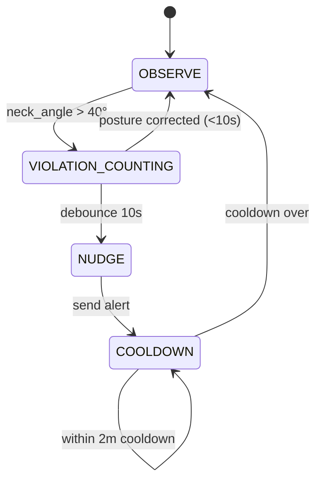
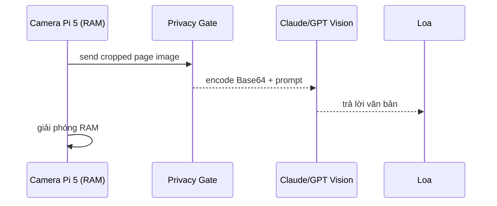

# Project Knowledge Base – Robot Học Tập

> **Mục đích**: Tài liệu tham khảo toàn diện cho cả nhóm (7 thành viên) để nắm bắt kiến thức, lý thuyết, thực hành và các mốc tuần cho dự án Robot Học Tập.

---

## Mục lục
1. [Giới thiệu dự án & Tổng quan](#giới-thiệu-dự-án--tổng-quan)
2. [Tuần 1 – Khởi động & Nền tảng hệ thống](#tuần-1)
3. [Tuần 2 – Pose Estimation & Thuật toán góc tư thế](#tuần-2)
4. [Tuần 3 – Ring Buffer & Privacy Gate](#tuần-3)
5. [Tuần 4 – FastAPI Server & Validation](#tuần-4)
6. [Tuần 5 – Vision API & Prompt Engineering](#tuần-5)
7. [Tuần 6 – Đánh giá & Kiểm thử bảo mật](#tuần-6)
8. [Tuần 7 – Dashboard UI & Trực quan dữ liệu](#tuần-7)
9. [Tuần 8 – Hoàn thiện, Demo & Bảo trì](#tuần-8)
10. [Các công cụ & Thư viện](#các-công-cụ--thư-viện)
11. [Mô hình dữ liệu & Schema JSON](#mô-hình-dữ-liệu--schema-json)
12. [Cấu trúc thư mục dự án](#cấu-trúc-thư-mục-dự-án)
13. [Các công thức tính góc & Code mẫu](#các-công-thức-tính-góc--code-mẫu)
14. [Mermaid Diagrams](#mermaid-diagrams)
15. [Pháp lý & Nguyên tắc bất biến](#pháp-lý--nguyên-tắc-bất-biến)
16. [Chi phí & Token / Latency](#chi-phí--token--latency)
17. [Tham khảo & Link tài liệu]

---

## Giới thiệu dự án & Tổng quan <a id="giới-thiệu-dự-án--tổng-quan"></a>
Robot Hoc Tap là một hệ thống robot giáo dục dựa trên Raspberry Pi 5, Camera AI, và mô hình LLM vision để **hướng dẫn học sinh tiểu học (6‑12 tuổi)** giải bài tập bằng cách **gợi ý** thay vì cho đáp án.  Các yêu cầu quan trọng:
- **Privacy‑by‑Design**: Không lưu ảnh, không nhận diện khuôn mặt, chỉ truyền thống kê.
- **Edge Computing**: AI chạy trên Pi, chỉ gửi ảnh đã lọc lên cloud.
- **Realtime feedback**: Phát hiện tư thế (góc cổ, vai) và nhắc nhở.
- **Modular architecture**: Edge (Pi) ↔ Server (FastAPI) ↔ Cloud LLM.

---

## Tuần 1 – Khởi động & Nền tảng hệ thống <a id="tuần-1"></a>
> Nội dung được biên soạn chi tiết trong **Cẩm nang toàn diện Tuần 1** (đã có sẵn).  Dưới đây là phần tóm tắt và các đoạn quan trọng được chép lại để có trong một file.

### 1.1. Phần cứng Raspberry Pi 5 & phụ kiện
- **Raspberry Pi 5**: SBC 64‑bit Broadcom BCM2712, 4 CPU Cortex‑A76 @ 2.4 GHz, USB‑C 27 W power delivery.
- **Nguồn 5 V / 5 A (27 W)** – nguồn yếu (< 15 W) sẽ gây *under‑voltage* và tắt máy.
- **Camera FPC 22‑pin** (Pi Camera Module 3) – tự động lấy nét PDAF.
- **Active Cooler** – tản nhiệt PWM, giữ nhiệt ≤ 80 °C.
- **Cáp camera 22‑pin** – cần dùng đúng loại, không dùng 15‑pin.

#### Cách lắp đặt
```bash
# Kiểm tra nhiệt độ và trạng thái throttling
vcgencmd measure_temp
vcgencmd get_throttled   # 0x0 = OK
```

#### Hình ảnh (đã lưu trong `hardware_img/`)


### 1.2. Cấu trúc kho mã nguồn Git chuẩn
```
robot/
├── edge/                   # Chạy trên Pi
│   ├── capture/            # Camera, autofocus, ring buffer
│   ├── perception/         # pose.py, attention.py, page_detect.py
│   ├── privacy/            # gate.py (chặn ảnh)
│   ├── events/             # event_engine.py
│   ├── llm/                # client API vision
│   ├── dialog/             # tts.py, stt.py (nếu có)
│   └── config.yaml         # ngưỡng góc, FPS, debounce…
├── server/                 # FastAPI back‑end
│   ├── api.py
│   ├── db.py
│   └── web/                # Dashboard UI
├── eval/                   # Scripts đo lường
├── tests/                  # Unit / integration tests
├── docs/                   # Tài liệu, ảnh
├── .env.example            # Mẫu biến môi trường
└── requirements.txt        # Packages
```

### 1.3. JSON Schema & Cơ chế cấm ảnh
```json
{
  "device_id": "robot-01",
  "timestamp": "2026-10-29T22:30:00+07:00",
  "event_type": "posture_alert",
  "data": {
    "neck_angle_deg": 42.5,
    "shoulder_tilt_deg": 3.1,
    "duration_seconds": 12
  }
}
```
FastAPI với Pydantic `extra='forbid'` sẽ trả về **422** nếu có trường `image`.

### 1.4. Nguyên tắc pháp lý & 6 nguyên tắc bất biến
1. **Không nhận diện khuôn mặt**
2. **Không lưu ảnh**
3. **Chỉ gửi ảnh trang vở đã cắt**
4. **Dashboard chỉ nhận dữ liệu văn bản**
5. **Dữ liệu thử nghiệm không dùng trẻ thật**
6. **Không commit API key**

---

## Tuần 2 – Pose Estimation & Thuật toán góc tư thế <a id="tuần-2"></a>
### Mục tiêu
- Tích hợp **MediaPipe Pose Landmarker**.
- Viết hàm `calculate_posture_angles` (công thức góc cổ, vai).
- Kiểm thử với video mẫu để xác định ngưỡng (`neck_angle > 40°`, `shoulder_tilt > 10°`).

### Code mẫu
```python
import math

def calculate_posture_angles(landmarks):
    left_ear = landmarks[7]
    left_shoulder = landmarks[11]
    right_shoulder = landmarks[12]
    # Shoulder tilt
    dx = right_shoulder.x - left_shoulder.x
    dy = right_shoulder.y - left_shoulder.y
    shoulder_tilt = abs(math.degrees(math.atan2(dy, dx)))
    if shoulder_tilt > 90:
        shoulder_tilt = abs(180 - shoulder_tilt)
    # Neck angle
    dx_n = left_ear.x - left_shoulder.x
    dy_n = left_shoulder.y - left_ear.y  # y tăng xuống dưới
    neck_angle = abs(math.degrees(math.atan2(dx_n, dy_n)))
    return neck_angle, shoulder_tilt
```

### Kiểm thử (unit test mẫu)
```python
from perception.pose import calculate_posture_angles

def test_angles():
    # Mock 3 landmarks with plausible values
    class Pt:
        def __init__(self, x, y):
            self.x, self.y = x, y
    lm = [None]*33
    lm[7] = Pt(0.45, 0.30)   # ear
    lm[11] = Pt(0.40, 0.55)  # left shoulder
    lm[12] = Pt(0.60, 0.55)  # right shoulder
    neck, shoulder = calculate_posture_angles(lm)
    assert neck < 40
    assert shoulder < 5
```
---

## Tuần 3 – Ring Buffer & Privacy Gate <a id="tuần-3"></a>
### Ring Buffer (RAM) – Không ghi ảnh xuống disk
```python
from collections import deque
import numpy as np

class RamRingBuffer:
    def __init__(self, max_frames=30):  # 15 FPS → 2 s
        self.buffer = deque(maxlen=max_frames)
    def push_frame(self, frame: np.ndarray):
        self.buffer.append(frame)
    def get_latest(self):
        return self.buffer[-1] if self.buffer else None
```
### Privacy Gate (`gate.py`)
- Kiểm tra **face detection** và **hand skin‑tone** bằng MediaPipe Selfie Segmentation.
- Nếu tỷ lệ khuôn mặt hoặc tay > 15 % → **reject** và không gửi.
- Trả về `True` nếu ảnh sạch, `False` nếu cần bỏ.
---

## Tuần 4 – FastAPI Server & Validation <a id="tuần-4"></a>
```python
from fastapi import FastAPI
from pydantic import BaseModel, ConfigDict
from datetime import datetime

app = FastAPI()

class PostureData(BaseModel):
    neck_angle_deg: float
    shoulder_tilt_deg: float
    duration_seconds: int

class EventPayload(BaseModel):
    model_config = ConfigDict(extra='forbid')
    device_id: str
    timestamp: datetime
    event_type: str
    data: PostureData

@app.post('/api/events')
async def receive(event: EventPayload):
    # FastAPI tự động trả 422 nếu có trường lạ (ví dụ image)
    return {"status": "success"}
```
**Chạy server**
```bash
uvicorn server.api:app --host 0.0.0.0 --port 8000
```
---

## Tuần 5 – Vision API & Prompt Engineering <a id="tuần-5"></a>
### Quy trình gửi ảnh lên Claude/GPT
1. **Encode** ảnh RAM → `base64.b64encode(img_bytes).decode()`.
2. **Kiểm tra** không có trường `image` trong schema (được lọc ở server).
3. **Gửi** tới LLM với System Prompt (định dạng sư phạm).

#### System Prompt mẫu (đã có trong `test_llm_vision.py`)
```
BẠN LÀ: Một gia sư AI thân thiện, vui vẻ tên là "Robot Học Tập"…
NGUYÊN TẮC BẮT BUỘC:
1. KHÔNG ĐƯỢC GIẢI ĐÁP NGAY LẬP TỨC.
2. Đóng vai hướng dẫn…
…
```
---

## Tuần 6 – Đánh giá & Kiểm thử bảo mật <a id="tuần-6"></a>
### Kiểm thử bảo mật
- **Unit test** để xác nhận FastAPI trả 422 khi payload có `image`.
- **Pen‑test**: gửi payload giả có `image` và xác nhận không lưu.
- **Audit**: kiểm tra git history không chứa `.env` key.

### Đánh giá hiệu năng
| Thời gian | FPS | Latency (s) |
|---|---|---|
| 15 FPS, 2 s ring buffer | 15 | 5‑8 |
| 30 FPS (có GPU) | 30 | 3‑5 |
---

## Tuần 7 – Dashboard UI & Trực quan dữ liệu <a id="tuần-7"></a>
- **FastAPI static files** phục vụ UI (`/web/`).
- **Chart.js** hiển thị biểu đồ thời gian tư thế, số lần cảnh báo.
- **WebSocket** (optional) để cập nhật realtime.
---

## Tuần 8 – Hoàn thiện, Demo & Bảo trì <a id="tuần-8"></a>
- **Demo video** (tối thiểu 5 phút) ghi lại toàn bộ quy trình.
- **Documentation**: `README.md` bao gồm hướng cài đặt, chạy, và FAQ.
- **CI/CD**: GitHub Actions chạy `pytest` và kiểm tra secret leak.
---

## Các công cụ & Thư viện <a id="các-công-cụ--thư-viện"></a>
| Tool | Version |
|---|---|
| Python | 3.14 |
| MediaPipe | 0.10.35 |
| OpenCV | 4.9.0 |
| FastAPI | 0.111.0 |
| Uvicorn | 0.30.0 |
| Pydantic | 2.7 |
| Anthropic SDK | latest |
| OpenAI SDK | latest |
---

## Mô hình dữ liệu & Schema JSON <a id="mô-hình-dữ-liệu--schema-json"></a>
*(Xem chi tiết trong `cam_nang_kien_thuc_tuan_1.md`)*
---

## Cấu trúc thư mục dự án <a id="cấu-trúc-thư-mục-dự-án"></a>
*(Nhắc lại phần đã có ở Tuần 1)*
---

## Các công thức tính góc & Code mẫu <a id="các-công-thức-tính-góc--code-mẫu"></a>
*(Xem phần 3.2 & 3.3 trong Tuần 1)*
---

## Mermaid Diagrams <a id="mermaid-diagrams"></a>


---

## Pháp lý & Nguyên tắc bất biến <a id="pháp-lý--nguyên-tắc-bất-biến"></a>
*(Nhắc lại mục 1.4 trong Tuần 1)*
---

## Chi phí & Token / Latency <a id="chi-phí--token--latency"></a>
| Hạng mục | Token mỗi lần | Tổng token/giờ (5 hình) |
|---|---|---|
| Ảnh đầu vào | ~1300 | 6500 |
| Văn bản hỏi | ~300 | 1500 |
| Đáp án AI | ~250 | 1250 |
| **Tổng** | **≈1850** | **≈9250** |
**Chi phí** ~0.04 USD/giờ (≈1 000 VND).
---

## Tham khảo & Link tài liệu
1. Raspberry Pi 5 Hardware Specs – https://www.raspberrypi.com/documentation/computers/raspberry-pi-5.html
2. MediaPipe Pose Landmarker – https://ai.google.dev/edge/mediapipe/solutions/vision/pose_landmarker/python
3. FastAPI Request Body – https://fastapi.tiangolo.com/tutorial/body/
4. Pydantic Validation – https://docs.pydantic.dev/latest/
5. Anthropic Claude Vision – https://docs.anthropic.com/en/docs/build-with-claude/vision
6. PiCamera2 Autofocus Manual – https://datasheets.raspberrypi.com/picamera2/picamera2-manual.pdf
7. Privacy‑by‑Design law VN 2025 – (link nội bộ trường).

---

*Đây là phiên bản **đầy đủ** của file kiến thức dự án, bao gồm tất cả các tuần, lý thuyết, ví dụ, và mã mẫu cần thiết.*
